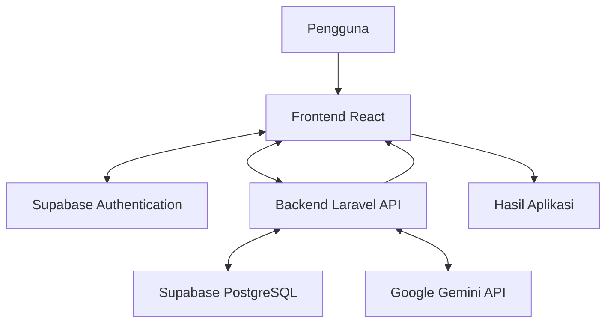

# NutriLens
### Understand What's Inside, Choose with Confidence.

NutriLens merupakan aplikasi berbasis web yang dirancang untuk membantu konsumen memahami informasi nilai gizi dan komposisi bahan makanan kemasan melalui penjelasan berbantuan Artificial Intelligence (AI), serta membandingkan produk untuk mendukung pengambilan keputusan konsumsi yang lebih bijak.

---

## 1. Pengenalan Proyek

### 1.1 Latar Belakang

Produk makanan dan minuman kemasan memiliki informasi nilai gizi dan daftar komposisi yang dapat digunakan konsumen sebagai bahan pertimbangan sebelum membeli. Namun, informasi tersebut tidak selalu mudah dipahami karena penggunaan istilah gizi yang kurang familiar, nama bahan yang kompleks, serta perbedaan komposisi antarproduk.

Selain itu, membandingkan kandungan beberapa produk secara manual dapat membutuhkan waktu dan ketelitian.

NutriLens dikembangkan sebagai solusi digital untuk membantu pengguna memahami informasi pada label makanan kemasan, memperoleh penjelasan mengenai bahan penyusun produk dengan bantuan AI, serta membandingkan informasi antarproduk secara lebih praktis.

### 1.2 Tujuan

- Membantu pengguna memahami informasi nilai gizi pada produk makanan kemasan.
- Memberikan penjelasan mengenai komposisi atau bahan penyusun produk dengan bantuan AI.
- Mempermudah pengguna membandingkan informasi beberapa produk.
- Mendukung pengambilan keputusan konsumsi berdasarkan informasi yang tersedia pada label produk.

### 1.3 Target Pengguna

NutriLens ditujukan kepada konsumen makanan dan minuman kemasan yang ingin memperoleh pemahaman lebih baik mengenai kandungan gizi dan komposisi produk sebelum melakukan pembelian.

### 1.4 Fitur Utama

| Fitur | Deskripsi |
|---|---|
| Autentikasi Pengguna | Memungkinkan pengguna melakukan registrasi dan login. |
| Pemindaian Produk | Menyediakan fitur untuk memasukkan informasi produk melalui antarmuka pemindaian. |
| Informasi Nilai Gizi | Menampilkan informasi kandungan gizi produk. |
| Penjelasan Bahan Berbasis AI | Memberikan penjelasan mengenai bahan penyusun produk menggunakan integrasi Google Gemini API. |
| Perbandingan Produk | Membantu pengguna membandingkan informasi kandungan beberapa produk. |
| Riwayat Pemindaian | Menampilkan riwayat aktivitas pemindaian pengguna. |

---

## 2. Dokumentasi Teknologi

### 2.1 Teknologi yang Digunakan

NutriLens dikembangkan menggunakan teknologi berikut:

| Komponen | Teknologi |
|---|---|
| Framework Frontend | React.js |
| Bahasa Pemrograman Frontend | TypeScript |
| Build Tool | Vite |
| Framework Backend | Laravel 13 |
| Bahasa Pemrograman Backend | PHP 8.3 |
| Sistem Manajemen Basis Data | PostgreSQL |
| Platform Basis Data | Supabase |
| Autentikasi | Supabase Auth |
| Integrasi AI | Google Gemini API |
| Version Control | Git dan GitHub |

### 2.2 Arsitektur Sistem

NutriLens menggunakan arsitektur dengan pemisahan antara frontend dan backend.

- **Frontend:** Bertanggung jawab atas tampilan aplikasi, navigasi, dan interaksi pengguna.
- **Backend:** Menangani logika aplikasi, pemrosesan permintaan API, serta komunikasi dengan layanan eksternal.
- **Supabase:** Menyediakan layanan autentikasi dan basis data PostgreSQL.
- **Google Gemini API:** Mendukung proses pemberian penjelasan berbantuan AI terhadap komposisi bahan makanan.

### 2.3 Diagram Arsitektur Sistem



### 2.4 Alur Kerja Aplikasi

1. Pengguna mengakses aplikasi NutriLens melalui browser.
2. Pengguna melakukan registrasi atau login.
3. Pengguna mengakses fitur pemindaian produk.
4. Pengguna memasukkan informasi produk melalui metode input yang tersedia.
5. Aplikasi memproses dan menampilkan informasi produk.
6. Informasi komposisi dapat diproses menggunakan Google Gemini API untuk memperoleh penjelasan berbantuan AI.
7. Hasil penjelasan ditampilkan melalui frontend.
8. Pengguna dapat memanfaatkan fitur perbandingan produk dan melihat riwayat pemindaian sesuai fitur yang tersedia.

---

## 3. Dokumentasi Frontend

### 3.1 Framework dan Library

Frontend NutriLens dikembangkan menggunakan React.js, TypeScript, dan Vite.

Teknologi pendukung yang digunakan meliputi:

- **React:** Membangun antarmuka aplikasi menggunakan komponen yang dapat digunakan kembali.
- **TypeScript:** Membantu menjaga konsistensi tipe data dan struktur kode.
- **Vite:** Menyediakan lingkungan pengembangan dan proses build frontend.
- **React Router:** Mengatur navigasi antarhalaman aplikasi.
- **Lucide React:** Menyediakan ikon untuk kebutuhan antarmuka.
- **Supabase JavaScript Client:** Menghubungkan frontend dengan layanan Supabase.

### 3.2 Struktur Direktori Frontend

Struktur utama direktori frontend:

```text
foodnutrition_fe/
├── public/
├── src/
│   ├── assets/
│   ├── components/
│   │   ├── common/
│   │   └── layout/
│   ├── context/
│   ├── pages/
│   ├── services/
│   ├── types/
│   ├── App.tsx
│   └── main.tsx
├── .env.example
├── package.json
└── vite.config.ts
```

### 3.3 Pembagian Komponen

| Direktori | Fungsi |
|---|---|
| `components/common` | Menyimpan komponen antarmuka umum yang dapat digunakan kembali. |
| `components/layout` | Mengatur struktur dan tata letak halaman aplikasi. |
| `context` | Mengelola state global aplikasi, termasuk konteks autentikasi. |
| `pages` | Menyimpan komponen halaman utama aplikasi. |
| `services` | Mengelola komunikasi dengan API dan layanan eksternal. |
| `types` | Menyimpan definisi tipe data TypeScript. |
| `assets` | Menyimpan aset statis yang digunakan aplikasi. |

### 3.4 Identitas Visual

NutriLens menggunakan identitas visual bernuansa hijau untuk merepresentasikan kesan segar, kesehatan, dan teknologi.

| Warna | Kode Warna |
|---|---|
| Hijau Utama | `#23865B` |
| Hijau Gelap | `#176B46` |
| Hijau Muda | `#E8F5ED` |
| Putih | `#FFFFFF` |
| Teks Gelap | `#171717` |

---

## 4. Dokumentasi Backend

### 4.1 Gambaran Umum Backend

Backend NutriLens dikembangkan menggunakan Laravel 13 dan PHP 8.3.

Backend bertanggung jawab dalam menangani logika aplikasi, menyediakan API, mengelola komunikasi dengan basis data, serta mengintegrasikan layanan eksternal seperti Google Gemini API.

### 4.2 API Endpoints

Berikut merupakan daftar endpoint API untuk pengelolaan data insight dan referensi sumber:

| Metode | Endpoint | Keterangan |
|---|---|---|
| GET | `/api/v1/insights` | Mengambil daftar data insight. |
| GET | `/api/v1/insights?search=gula` | Mencari data insight berdasarkan kata kunci. |
| GET | `/api/v1/insights/{id}` | Mengambil detail data insight berdasarkan ID. |
| GET | `/api/v1/source-references` | Mengambil daftar referensi sumber. |
| GET | `/api/v1/source-references/{id}` | Mengambil detail referensi sumber berdasarkan ID. |

### 4.3 Dokumentasi Basis Data

NutriLens menggunakan PostgreSQL sebagai sistem manajemen basis data dengan Supabase sebagai platform pengelolanya.

Tabel yang digunakan dalam pengembangan backend:

| Nama Tabel | Fungsi |
|---|---|
| `insights` | Menyimpan data insight atau informasi yang digunakan aplikasi. |
| `source_references` | Menyimpan referensi sumber informasi yang berkaitan dengan data insight. |

Pengelolaan struktur tabel dilakukan menggunakan migration Laravel.

### 4.4 Integrasi Google Gemini API

NutriLens mengintegrasikan Google Gemini API untuk mendukung pemberian penjelasan mengenai komposisi bahan makanan.

Alur integrasi:

1. Backend menerima informasi komposisi bahan yang akan dijelaskan.
2. Backend mengirimkan permintaan ke Google Gemini API.
3. Gemini memproses permintaan dan menghasilkan penjelasan.
4. Backend menerima respons dari layanan Gemini.
5. Hasil penjelasan diteruskan ke frontend untuk ditampilkan kepada pengguna.

API key Gemini disimpan pada konfigurasi environment backend dan tidak ditempatkan secara langsung dalam kode frontend maupun repository publik.

---

## 5. Konfigurasi Environment

Konfigurasi aplikasi disimpan menggunakan environment variable untuk mengatur koneksi layanan serta menjaga keamanan informasi kredensial.

### 5.1 Konfigurasi Backend

Buat file `.env` pada direktori backend Laravel berdasarkan file `.env.example`.

Contoh konfigurasi:

```env
APP_NAME=NutriLens
APP_ENV=local
APP_KEY=
APP_DEBUG=true
APP_URL=http://127.0.0.1:8000

DB_CONNECTION=pgsql
DB_HOST=your_supabase_host
DB_PORT=5432
DB_DATABASE=postgres
DB_USERNAME=your_database_username
DB_PASSWORD=your_database_password

GEMINI_API_KEY=your_gemini_api_key
```

### 5.2 Konfigurasi Frontend

Buat file `.env` di dalam direktori `foodnutrition_fe`.

Contoh konfigurasi:

```env
VITE_SUPABASE_URL=your_supabase_project_url
VITE_SUPABASE_PUBLISHABLE_KEY=your_supabase_publishable_key
```

### 5.3 Keamanan Konfigurasi

- File `.env` asli tidak boleh diunggah ke repository publik.
- API key Gemini tidak boleh ditempatkan dalam kode frontend.
- Supabase Secret Key atau Service Role Key tidak boleh diekspos kepada pengguna.
- File `.env.example` digunakan sebagai contoh konfigurasi tanpa menyertakan kredensial asli.
- Setiap pengembang harus mengisi kredensial yang valid pada file `.env` masing-masing.

---

## 6. Petunjuk Instalasi dan Menjalankan Aplikasi

### 6.1 Persyaratan Sistem

Sebelum menjalankan NutriLens, pastikan perangkat telah memiliki:

- PHP 8.3 atau versi yang sesuai dengan kebutuhan proyek.
- Composer.
- Node.js dan npm.
- Git.
- Akses ke proyek Supabase dan kredensial basis data.
- Google Gemini API key.

### 6.2 Mengunduh Repository

Clone repository NutriLens dari GitHub:

```bash
git clone https://github.com/lintangtrisha/foodnutrition.git
```

Masuk ke direktori repository:

```bash
cd foodnutrition
```

### 6.3 Menjalankan Backend Laravel

Masuk ke direktori backend Laravel sesuai struktur repository.

Instal seluruh dependency:

```bash
composer install
```

Buat file `.env` berdasarkan `.env.example`, kemudian sesuaikan konfigurasi basis data dan API key Gemini.

Buat application key Laravel:

```bash
php artisan key:generate
```

Jalankan server backend:

```bash
php artisan serve
```

Backend dapat diakses melalui:

```text
http://127.0.0.1:8000
```

### 6.4 Menjalankan Frontend

Buka terminal baru, kemudian masuk ke direktori frontend:

```bash
cd foodnutrition_fe
```

Instal dependency:

```bash
npm install
```

Buat file `.env` berdasarkan `.env.example`, kemudian isi konfigurasi Supabase yang diperlukan.

Jalankan development server:

```bash
npm run dev
```

Frontend dapat diakses melalui:

```text
http://localhost:5173
```

### 6.5 Mengakses Aplikasi

Setelah backend dan frontend berhasil dijalankan, buka browser dan akses:

```text
http://localhost:5173
```

Pastikan server backend dan frontend tetap berjalan selama aplikasi digunakan.

---

## 7. Repository GitHub

Repository resmi NutriLens:

**https://github.com/lintangtrisha/foodnutrition**

Repository ini memuat kode sumber aplikasi dan dokumentasi proyek yang dapat digunakan untuk proses pengembangan, pemeriksaan, dan evaluasi.

---

## 8. Keamanan dan Penggunaan yang Bertanggung Jawab

- Informasi kredensial disimpan menggunakan environment variable.
- File `.env` asli tidak disertakan dalam repository publik.
- Integrasi layanan eksternal dilakukan melalui backend dengan memperhatikan keamanan kredensial.
- Hasil penjelasan berbantuan AI merupakan informasi pendukung yang perlu dipahami bersama informasi asli pada label produk.
- Informasi nilai gizi dan komposisi produk tetap mengacu pada data yang tersedia pada label produk.

---

## 9. Penutup

NutriLens dikembangkan sebagai upaya memanfaatkan teknologi web dan Artificial Intelligence untuk membantu masyarakat memahami informasi pada label makanan kemasan dengan lebih mudah.

Melalui fitur pemindaian, penjelasan komposisi berbantuan AI, dan perbandingan produk, NutriLens diharapkan dapat mendukung konsumen dalam mengambil keputusan konsumsi berdasarkan informasi yang lebih mudah dipahami.

**NutriLens — Understand What's Inside, Choose with Confidence.**
